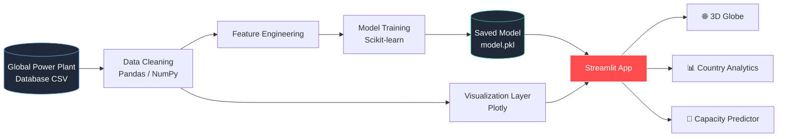

<div align="center">

# 🌍 Global Power Plant Analytics

### Interactive 3D dashboard and ML capacity predictor for worldwide energy infrastructure

<p>
  
  
  
  
  
  
</p>

<p>
  <a href="#-live-demo"><b>Live Demo</b></a> •
  <a href="#-features"><b>Features</b></a> •
  <a href="#-architecture"><b>Architecture</b></a> •
  <a href="#-getting-started"><b>Getting Started</b></a> •
  <a href="#-machine-learning"><b>ML Model</b></a> •
  <a href="#-roadmap"><b>Roadmap</b></a>
</p>

<!-- Replace with a real GIF or screenshot of the 3D globe -->


</div>

---

## 📑 Table of Contents

<details open>
<summary><b>Click to expand / collapse</b></summary>

1. [Overview](#-overview)
2. [Live Demo](#-live-demo)
3. [Features](#-features)
4. [Architecture](#-architecture)
5. [Tech Stack](#-tech-stack)
6. [Dataset](#-dataset)
7. [Project Structure](#-project-structure)
8. [Getting Started](#-getting-started)
9. [Machine Learning](#-machine-learning)
10. [Key Insights](#-key-insights)
11. [Roadmap](#-roadmap)
12. [Contributing](#-contributing)
13. [License](#-license)
14. [Author](#-author)

</details>

---

## 🔭 Overview

This project turns the **Global Power Plant Database** into an interactive analytics platform. It lets users explore global energy infrastructure on a rotatable 3D globe, drill into country-level generation mix, and predict plant capacity with a trained regression model.

**Why it matters:** energy data is large, skewed, and geographically complex. Interactive visualization and predictive modeling make it accessible to analysts, researchers, and non-technical stakeholders alike.

---

## 🚀 Live Demo

| Resource | Link |
|---|---|
| 🌐 Deployed App | `[your-streamlit-app-url]` |
| 🎥 Video Walkthrough | `[your-video-url]` |
| 📓 Notebook | `[link-to-notebook]` |

---

## ✨ Features

<table>
  <tr>
    <td width="50%" valign="top">

### 🌐 3D Global Map
- Rotatable orthographic globe
- Marker size scaled by capacity (MW)
- Color-coded by primary fuel type
- Hover tooltips with plant details

</td>
    <td width="50%" valign="top">

### 📊 Country Analysis
- Plant count and total capacity per country
- Fuel mix breakdown
- Top-N country rankings
- Side-by-side country comparison

</td>
  </tr>
  <tr>
    <td width="50%" valign="top">

### ⚡ Energy Source Insights
- Capacity distribution (log-scaled)
- Renewable vs. non-renewable split
- Fuel share by region
- Interactive filters and sliders

</td>
    <td width="50%" valign="top">

### 🤖 ML Capacity Predictor
- Predict plant capacity (MW)
- Inputs: fuel type, country, coordinates
- Model metrics shown in-app
- Feature importance visualization

</td>
  </tr>
</table>

---

## 🏗 Architecture



<details>
<summary><b>🔎 Pipeline breakdown</b></summary>

| Stage | Responsibility |
|---|---|
| **Ingest** | Load the raw CSV and validate schema |
| **Clean** | Handle missing values, duplicates, and outliers |
| **Engineer** | Encode fuel type and country, derive geographic and aggregate features |
| **Train** | Fit and evaluate regression models with cross-validation |
| **Serve** | Streamlit loads cached data and the saved model |
| **Visualize** | Plotly renders the globe, charts, and comparisons |

</details>

---

## 🧰 Tech Stack

| Layer | Tools |
|---|---|
| **Language** | Python 3.10+ |
| **Data** | Pandas, NumPy |
| **Machine Learning** | Scikit-learn |
| **Visualization** | Plotly (3D orthographic globe, charts) |
| **Web App** | Streamlit |
| **Deployment** | Streamlit Community Cloud |

---

## 🗂 Dataset

**Source:** [WRI Global Power Plant Database](https://datasets.wri.org/dataset/globalpowerplantdatabase)

| Field | Description |
|---|---|
| `country` / `country_long` | Country code and name |
| `name` | Plant name |
| `capacity_mw` | Installed generation capacity (MW) |
| `primary_fuel` | Coal, Gas, Hydro, Solar, Wind, Nuclear, etc. |
| `owner` | Plant ownership |
| `latitude`, `longitude` | Geographic coordinates |

> **Records:** `[N]` plants • **Countries:** `[N]` • **Fuel types:** `[N]`
> Replace with real values from `len(df)`, `df.country.nunique()`, `df.primary_fuel.nunique()`.

---

## 📁 Project Structure

```text
global-power-plant-analytics/
│
├── 📂 data/
│   ├── raw/                    # Original dataset
│   └── processed/              # Cleaned data
│
├── 📂 notebooks/
│   └── eda_and_modeling.ipynb  # Exploration and experiments
│
├── 📂 src/
│   ├── data_loader.py          # Loading and cleaning
│   ├── features.py             # Feature engineering
│   ├── train.py                # Model training and evaluation
│   └── visuals.py              # Plotly chart builders
│
├── 📂 models/
│   └── model.pkl               # Trained model
│
├── 📂 assets/
│   └── demo.gif                # README media
│
├── app.py                      # Streamlit entry point
├── requirements.txt
├── LICENSE
└── README.md
```

---

## ⚙️ Getting Started

### Prerequisites
- Python **3.10+**
- `pip` or `conda`

### Installation

```bash
# 1. Clone the repository
git clone https://github.com/[your-username]/global-power-plant-analytics.git
cd global-power-plant-analytics

# 2. Create a virtual environment
python -m venv venv
source venv/bin/activate        # Windows: venv\Scripts\activate

# 3. Install dependencies
pip install -r requirements.txt
```

### Run the app

```bash
streamlit run app.py
```

Open **http://localhost:8501** in your browser.

### (Optional) Retrain the model

```bash
python src/train.py
```

---

## 🤖 Machine Learning

**Task:** Regression, predicting `capacity_mw` for a power plant.

| Item | Details |
|---|---|
| **Target** | `capacity_mw` (log-transformed to handle skew) |
| **Features** | Primary fuel, country, latitude, longitude, `[others]` |
| **Models tested** | `[Linear Regression, Random Forest, Gradient Boosting]` |
| **Validation** | 5-fold cross-validation |

### 📈 Performance

| Metric | Score |
|---|---|
| R² | `[value]` |
| MAE | `[value]` MW |
| RMSE | `[value]` MW |

> Fill in with your real evaluation results.

---

## 💡 Key Insights

- ⚖️ **Heavy skew:** a small share of plants holds a large share of global capacity, so log-scaling was essential.
- 🔥 **Fuel and geography** were the strongest predictors of capacity.
- 🌱 **Renewable growth** varies sharply by region, visible in the fuel-mix views.

> Replace with findings verified against your own analysis.

---

## 🗺 Roadmap

- [x] Data cleaning and EDA
- [x] Interactive Streamlit dashboard
- [x] 3D globe visualization
- [x] ML capacity prediction
- [ ] Time-series generation trends
- [ ] SHAP model explainability
- [ ] REST API for predictions (FastAPI)
- [ ] Docker containerization
- [ ] CI/CD with automated tests

---

## 🤝 Contributing

Contributions are welcome.

1. Fork the repo
2. Create a branch: `git checkout -b feature/your-feature`
3. Commit: `git commit -m "Add your feature"`
4. Push: `git push origin feature/your-feature`
5. Open a Pull Request

---

## 📄 License

Distributed under the **MIT License**. See [`LICENSE`](LICENSE) for details.

---

## 👤 Author

<div align="center">

**[vaibhavi sharnagat]**


[](https://linkedin.com/in/[your-profile])
[](https://github.com/[your-username])

⭐ **If this project helped you, consider giving it a star.** ⭐

</div>
